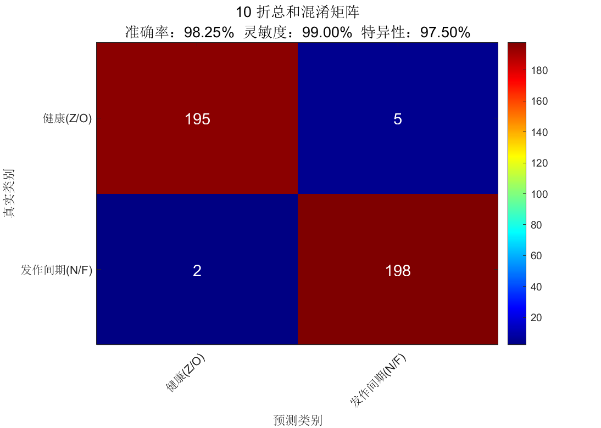
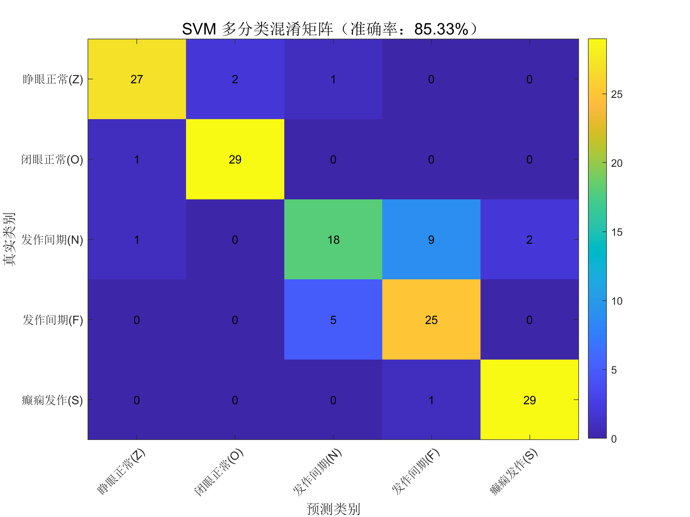

# EEG 片段分类（MATLAB）

本科毕业设计。基于波恩大学公开 EEG 数据集，从 500 段单通道信号中提取 16 维时频特征，训练 SVM 完成状态分类。

数据集包含五组：A、B 组来自健康志愿者（睁眼与闭眼），C、D 组来自癫痫患者的发作间期（分别记录于病灶对侧与同侧），E 组为发作期。本研究属于片段级分类任务：给定一段 23.6 秒的信号，判定其所属类别。

需要指出的是，本研究不构成发作预测。C、D 两组为发作间期（interictal）而非发作前（preictal），数据集本身也不包含连续长时记录，无法支撑"预测"这一结论。此外，交叉验证按片段随机划分，同一被试的多个片段可能同时进入训练集与测试集，存在信息泄漏，指标会偏高。

## 结果

二分类（健康 Z/O 与发作间期 N/F），10 折交叉验证：准确率 98.25%，灵敏度 99.00%，特异性 97.50%，F1 98.28%。



该指标需结合前述两点理解。任务本身区分的是"两类人群与两种记录条件"，健康人与患者的脑电存在系统性差异；加之按片段随机划分，模型可能记忆被试身份而非状态特征。因此 98% 更适合作为"特征具有判别力"的证据，不足以作为"可预测发作"的依据。

另一对照组采用 70/30 划分并引入类别加权，准确率 97.33%，发作类召回率 100%：30 个发作样本全部检出，代价为 4 个正常样本误报。预警场景下这一取舍是合理的。

两组二分类使用的样本量不同：10 折实验仅取 Z/O/N/F 四类共 400 段，不含 E 组；加权对照组使用全部 500 段，测试集为 150 个。因此两个混淆矩阵的样本总数不一致属于预期情况。

五类多分类准确率为 85.33%，较二分类下降 12.9 个百分点。混淆矩阵显示误差集中于 N 与 F 之间：



N 与 F 互相误判 14 次，占全部 22 个错误样本的 63.6%；Z、O、S 三类之间几乎没有混淆。N、F 两组同属患者发作间期，区别仅在于记录部位（病灶两侧），在特征空间中距离较近。剩余约 15% 的误差主要源于同一状态在不同记录条件下难以区分，而非模型未能习得状态本身。

所有脚本均设置 `rng(42)`，上述指标可复现。原始版本未固定随机种子，同一份代码两次运行的准确率相差约 1–2 个百分点。

## 数据集

波恩大学 EEG 数据库（Bonn University EEG Database），5 组各 100 段，每段 23.6 秒，单通道，采样率 173.61 Hz。

| 目录 | 组 | 内容 |
|---|---|---|
| `A_Z/` | A | 健康志愿者，睁眼 |
| `B_O/` | B | 健康志愿者，闭眼 |
| `C_N/` | C | 患者发作间期，病灶对侧海马 |
| `D_F/` | D | 患者发作间期，病灶同侧海马 |
| `E_S/` | E | 患者发作期 |

原始数据未纳入仓库：一是第三方数据有独立使用条款，二是体积约 5 MB。仓库中的 `data/bonn_features.mat` 为已提取的特征矩阵（500 × 18），可满足全部模型脚本的运行需求。如需重新提取特征，按 `data/README.md` 将原始数据置于 `data/bonn/` 目录下。

## 代码结构

```
src/
  main_extract_features.m   遍历五组 → 预处理 → 提取 16 维特征 → 保存 mat
  preprocess_demo.m         单片段四联频谱对比，展示各级滤波效果
  svm_binary_10fold.m       健康与发作间期二分类，10 折交叉验证
  svm_binary_weighted.m     二分类对照，70/30 划分并引入类别加权
  svm_multiclass.m          五类状态多分类
  feature_pca.m             16 维特征投影至前两个主成分
  feature_boxplot.m         过零率、RMS、α 占比三个特征的分布对比
```

运行环境为 MATLAB R2021b 及以上，依赖 Statistics and Machine Learning Toolbox（`fitcsvm`、`fitcecoc`、`pca`、`boxplot`）与 Signal Processing Toolbox（`iirnotch`、`butter`、`filtfilt`）。

仅运行模型时无需原始数据：

```matlab
cd src
svm_binary_10fold
svm_multiclass
```

各脚本通过 `mfilename('fullpath')` 定位仓库根目录，不依赖当前工作目录，可直接在 MATLAB 中运行。

## 特征提取

预处理分为四步：

| 步骤 | 做法 | 目的 |
|---|---|---|
| 基线校正 | `detrend` 线性去趋势 | 电极极化会产生缓慢漂移，不去除将污染低频功率 |
| 工频陷波 | `iirnotch`，Q = 35 | 滤除 50 Hz 电网干扰 |
| 带通滤波 | 4 阶 Butterworth，0.5–40 Hz | 保留脑电有效频段，滤除超低频漂移与高频肌电 |
| 异常值截断 | ±3σ | 防止单个尖峰主导 RMS、最大值等特征 |

所有滤波均采用 `filtfilt` 实现零相位处理，避免波形在时间轴上整体偏移。

16 维特征由三部分构成：时域 9 个（均值、标准差、方差、峰度、偏度、RMS、最大值、最小值、绝对均值），过零率 1 个，频域 6 个（总功率与 δ/θ/α/β/γ 五个频段功率占比）。

过零率的计算先减去均值再统计符号变化。若不去除直流分量，信号几乎全为同一符号，过零率将被压低至接近 0。

频域特征采用功率占比而非绝对功率：不同被试的绝对幅值可能相差数倍，而各节律的相对强弱具有可比性。

## 局限性

除前述被试级泄漏外，本项目还有三方面不足。

特征未做筛选，16 维全部使用。若引入 mRMR 或递归特征消除，可能以约一半的特征取得相近效果，且更便于解释。

手工特征的表达能力存在上限。16 个统计量在二分类任务上可达 98%，多分类任务降至 85%。改用 EEGNet 等模型通常有明显提升，但需要更多数据与调参投入。

尚未开展真正的预测任务。若要实现发作预测，需使用 CHB-MIT 等连续记录数据集，自行划分 preictal 时间窗。本项目的预处理与特征提取部分可复用，但实验设计需重新构建。

## 参考文献

- R. G. Andrzejak, et al. *Indications of nonlinear deterministic and finite-dimensional structures in time series of brain electrical activity: Dependence on recording region and brain state.* Physical Review E, 64(6): 061907, 2001.
- 数据集主页：<https://www.ukbonn.de/epileptologie/arbeitsgruppen/ag-lehnertz-neurophysik/downloads/>

MIT License
